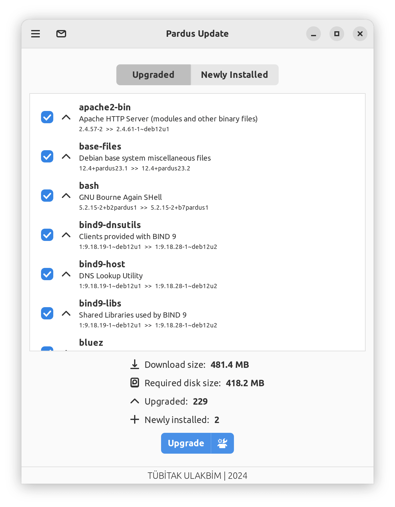
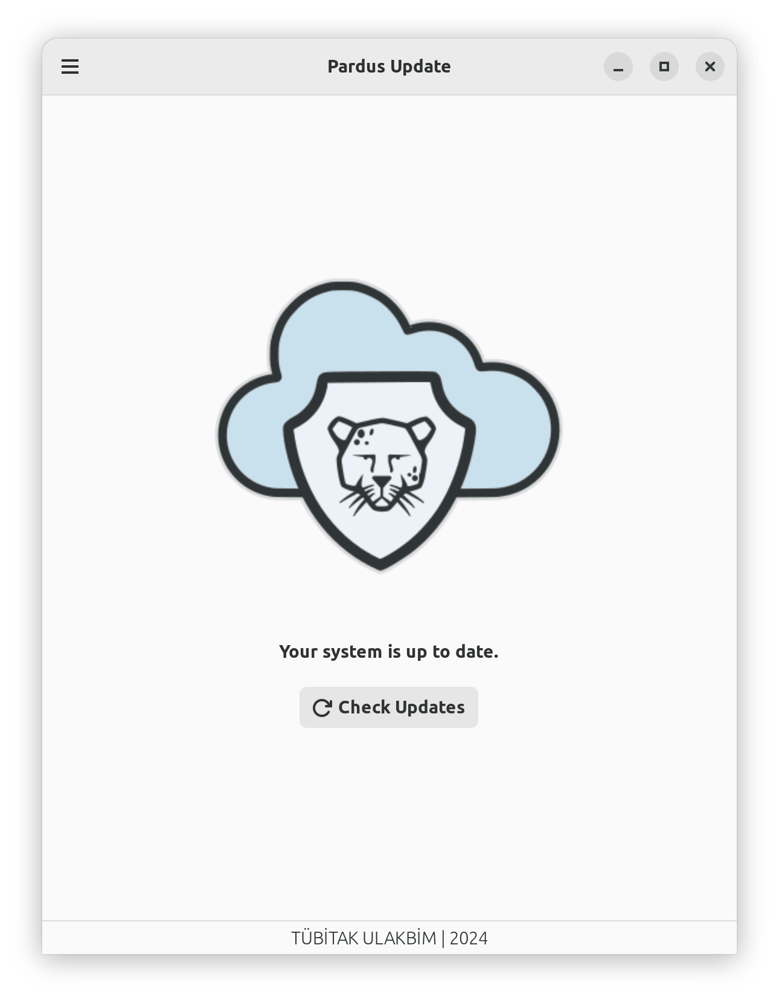

# Pars Update (pars-update)

**Pars Update**, Pars Linux, Arch Linux ve Debian tabanlı işletim sistemleri için geliştirilmiş, çoklu paket yöneticisi (Pacman & APT) destekli, hafif, güvenli ve modern bir grafiksel güncelleme yöneticisidir.

---

## 🌟 Temel Özellikler

* **Çift Paket Yöneticisi Desteği:** Arch Linux (`pacman`) ve Debian (`apt`) sistemlerini otomatik algılayıp yerel araçlarıyla çalışma.
* **Modern ve Sade Arayüz:** GTK+ 3 ve VTE terminal entegrasyonu ile canlı güncelleme çıktıları.
* **Sistem Tepsisi (Tray) Bildirimi:** Ayatana AppIndicator ile sistem durumunu ve bekleyen güncelleme sayısını arka plandan takip etme.
* **Güvenli Çevrimdışı Güncelleme:** Systemd `system-update.target` ve Plymouth açılış ekranı üzerinden oturumu riske atmadan güvenli yükseltme.
* **Yetki Ayrımı (Polkit):** GUI süreci yetkisiz çalışırken, paket işlemleri Polkit üzerinden güvenli şekilde yürütülür.
* **Parolasız Güncelleme:** İsteğe bağlı `pars-update` grubu ile her güncellemede parola girmeden işlem yapabilme.
* **Önbellek & Artık Paket Temizliği:** İndirilen paket önbelleklerini ve yetim (orphan) bağımlılıkları tek tıkla temizleme.
* **Kaynak Listesi Onarımı:** Bozuk kaynak listesi girdilerini tespit edip yönetebilme.
* **Seçilebilir Güncellemeler:** Kullanıcının yalnızca istediği paketleri seçerek güncelleyebilmesi.

---

## 📸 Ekran Görüntüleri

| Ana Güncelleme Ekranı | Paket Seçimi ve Detaylar |
| :---: | :---: |
|  |  |

---

## 🚀 Hızlı Başlangıç

### 1. Tek Komutla Otomatik Kurulum
Bağımlılıkları otomatik kurup uygulamayı sisteme yüklemek için (Arch ve Debian otomatik algılanır):
```bash
sudo ./install.sh
```

### 2. Kolay Çalıştırma
```bash
./run.sh
# veya sistem tepsisi modunda:
./run.sh --tray
```

### 3. Kaldırma
```bash
sudo ./uninstall.sh
```

### 4. Paket Derleme
* **Arch Linux (PKGBUILD):**
  ```bash
  makepkg -si
  ```
* **Debian (.deb):**
  ```bash
  sudo apt install -y devscripts git-buildpackage
  gbp buildpackage --git-export-dir=/tmp/build/pars-update -us -uc
  ```

---

## 📚 Dokümantasyon Rehberi (Docs Index)

Projenin tüm teknik, operasyonel ve kullanıcı dokümanlarına aşağıdaki bağlantılardan ulaşabilirsiniz:

### Çekirdek ve Sistem Dokümantasyonu
* 🏗️ **[Sistem Mimarisi (ARCHITECTURE.md)](ARCHITECTURE.md)**: Çift katmanlı süreç mimarisi, Polkit ve IPC entegrasyonu.
* 📦 **[Kurulum Kılavuzu (INSTALL.md)](INSTALL.md)**: Ayrıntılı derleme, bağımlılıklar ve kurulum adımları.
* 🛡️ **[Güvenlik Politikası (SECURITY.md)](SECURITY.md)**: Yetki ayrımı, girdi doğrulama ve güvenlik açığı bildirim süreci.
* 💻 **[Komut Satırı Referansı (CLI_REFERENCE.md)](CLI_REFERENCE.md)**: `pars-update` ve arka plan betiklerinin tüm parametreleri.

### Entegrasyon ve Yönetim Kılavuzları
* 🔗 **[Uygulama ve Masaüstü Entegrasyonu (UYGULAMA_BAGLAMA.md)](UYGULAMA_BAGLAMA.md)**: Desktop dosyaları, otomatik başlatma ve harici çağırma.
* 🌐 **[Özel Depo ve Sunucu Barındırma (SELF_HOSTING_GUIDE.md)](SELF_HOSTING_GUIDE.md)**: Kurumsal APT deposu ve `dists.json` sürüm uç noktası kurulumu.
* 💾 **[Veri ve Kota Tasarrufu (DATA_SAVING_GUIDE.md)](DATA_SAVING_GUIDE.md)**: Disk alanı ve mobil internet kotası tasarruf yöntemleri.

### Geliştirme ve Topluluk
* 🤝 **[Katkı Sağlama Rehberi (CONTRIBUTING.md)](CONTRIBUTING.md)**: PR iş akışı, kod standartları ve kurallar.
* 🧪 **[Test ve Kalite Güvencesi (TESTING.md)](TESTING.md)**: Birim, arayüz ve paket derleme testleri.
* 🌍 **[Çeviri Kılavuzu (TRANSLATION_GUIDE.md)](TRANSLATION_GUIDE.md)**: GNU gettext ile yeni dil ekleme ve güncelleme.
* 🤖 **[AI & Asistan Yönergesi (CLAUDE.md)](CLAUDE.md)**: AI ajanları ve geliştiriciler için mimari standartlar.
* 📈 **[İlerleme ve Yol Haritası (progress.md)](progress.md)**: Tamamlanan ve planlanan özellikler.
* 🏷️ **[Sürüm Yönetimi (VERSION.md)](VERSION.md)**: SemVer sürümleme politikası ve yayınlama adımları.
* 📜 **[Değişiklik Günlüğü (CHANGELOG.md)](CHANGELOG.md)**: Sürümler arası detaylı değişiklik listesi.

### Hukuki ve Finansal Prensipler
* ⚖️ **[Kullanım Şartları ve Garanti Reddi (TERMS.md / SARTLAR.md)](TERMS.md)**: GPLv3 lisanslama ve sorumluluk sınırları.
* 💳 **[Finansman ve Bağış Modeli (PAYMENT_INTEGRATION.md)](PAYMENT_INTEGRATION.md)**: Ticari olmayan açık kaynak yapısı ve bağış kanalları.

---

## 📄 Lisans
Bu proje [GNU Genel Kamu Lisansı Sürüm 3 (GPLv3)](../LICENSE) altında lisanslanmıştır.
